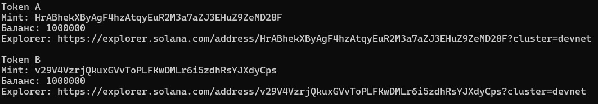
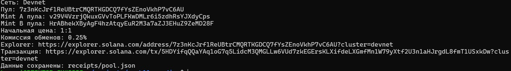
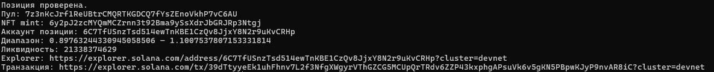
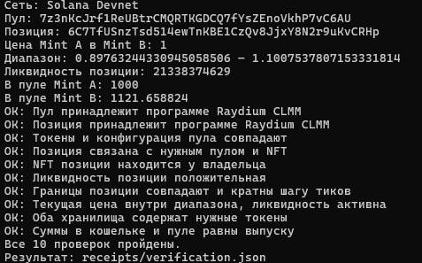

# Задание 11 — пул и позиция Raydium CLMM

Кариева Карина. AlmaU.

## Цель работы

Создать два тестовых SPL-токена в Solana Devnet, создать пул Raydium CLMM
и открыть позицию ликвидности из собственного кошелька.

## Что выполнено

1. Созданы Token A и Token B: по 1 000 000 токенов, 6 знаков после запятой.
2. Создан пул Raydium CLMM с начальной ценой 1:1.
3. Выбрана конфигурация с комиссией обменов 0.25% и шагом тиков 60.
4. Открыта позиция и внесена ликвидность в обоих токенах.
5. Проверены аккаунты пула, NFT позиции, диапазон и балансы.

Использована программа Raydium CLMM:
[DRayAUgENGQBKVaX8owNhgzkEDyoHTGVEGHVJT1E9pfH](https://explorer.solana.com/address/DRayAUgENGQBKVaX8owNhgzkEDyoHTGVEGHVJT1E9pfH?cluster=devnet).

## Цена и выбранный диапазон

Цена при открытии: **1 Mint B за 1 Mint A**.

Границы позиции: **0.89763244330945058506–1.1007537807153331814**.

Тики: **-1080** и **960**.

Я выбрала диапазон примерно от 0.9 до 1.1 вокруг начальной цены 1.
Это позволяет разместить ликвидность рядом с текущей ценой и оставить
запас для её изменения. Границы округлены наружу до допустимых тиков,
кратных 60. При выходе цены из диапазона позиция перестанет предоставлять
активную ликвидность до возвращения цены в диапазон.

Цена на момент итоговой проверки: **1**.

## Внесённая ликвидность

| Параметр | Результат |
|---|---|
| Mint A в пуле | 1000 |
| Mint B в пуле | 1121.658824 |
| Ликвидность позиции, внутренние единицы CLMM | 21338374629 |
| Итоговая проверка | 10 из 10 проверок пройдены |

В скрипте открытия для второго токена задан максимальный расход
с запасом 1%. Фактически в пул поступили суммы, указанные в таблице.

Raydium сортирует mint-адреса. Поэтому Mint A пула соответствует
созданному Token B, а Mint B пула — созданному Token A.
Обозначения Token A и Token B используются в проекте;
отдельные метаданные названий для этих SPL-токенов не создавались.

## Адреса Devnet

| Аккаунт | Ссылка |
|---|---|
| Кошелёк владельца | [GCELxq8keKXzd1Q27D9KzW5z2nw6JzLHyHH592okLfoy](https://explorer.solana.com/address/GCELxq8keKXzd1Q27D9KzW5z2nw6JzLHyHH592okLfoy?cluster=devnet) |
| Созданный Token A | [HrABhekXByAgF4hzAtqyEuR2M3a7aZJ3EHuZ9ZeMD28F](https://explorer.solana.com/address/HrABhekXByAgF4hzAtqyEuR2M3a7aZJ3EHuZ9ZeMD28F?cluster=devnet) |
| Созданный Token B | [v29V4VzrjQkuxGVvToPLFKwDMLr6i5zdhRsYJXdyCps](https://explorer.solana.com/address/v29V4VzrjQkuxGVvToPLFKwDMLr6i5zdhRsYJXdyCps?cluster=devnet) |
| Пул | [7z3nKcJrf1ReUBtrCMQRTKGDCQ7fYsZEnoVkhP7vC6AU](https://explorer.solana.com/address/7z3nKcJrf1ReUBtrCMQRTKGDCQ7fYsZEnoVkhP7vC6AU?cluster=devnet) |
| Конфигурация | [CD4aJtX11cqTCAc83nxSPkkh5JW2yjD6uwHeovjqQ1qu](https://explorer.solana.com/address/CD4aJtX11cqTCAc83nxSPkkh5JW2yjD6uwHeovjqQ1qu?cluster=devnet) |
| Хранилище Mint A | [H8LpXY4Ngwakq5ygmeZk8aUnqv3baKCTVVedbfZBBzvp](https://explorer.solana.com/address/H8LpXY4Ngwakq5ygmeZk8aUnqv3baKCTVVedbfZBBzvp?cluster=devnet) |
| Хранилище Mint B | [75pFmwDqZoJSF1rM1wgrysLZ5cCmKsSWwK1dPDmG3hH1](https://explorer.solana.com/address/75pFmwDqZoJSF1rM1wgrysLZ5cCmKsSWwK1dPDmG3hH1?cluster=devnet) |
| Аккаунт позиции | [6C7TfUSnzTsd514ewTnKBE1CzQv8JjxY8N2r9uKvCRHp](https://explorer.solana.com/address/6C7TfUSnzTsd514ewTnKBE1CzQv8JjxY8N2r9uKvCRHp?cluster=devnet) |
| NFT mint позиции | [6y2pJ2zcMYQmMCZrnn3t92Bma9ySsXdrJbGRJRp3Ntgj](https://explorer.solana.com/address/6y2pJ2zcMYQmMCZrnn3t92Bma9ySsXdrJbGRJRp3Ntgj?cluster=devnet) |
| Токеновый аккаунт NFT | [Gsjpch7tktd3exvXokvb3agNS2evgZs8BZ8mHrG5hzHW](https://explorer.solana.com/address/Gsjpch7tktd3exvXokvb3agNS2evgZs8BZ8mHrG5hzHW?cluster=devnet) |
| Нижний массив тиков | [8zzUiXkmFFvCy5ofvtfJszdH2F6JYoSZ2YYqejhVjagr](https://explorer.solana.com/address/8zzUiXkmFFvCy5ofvtfJszdH2F6JYoSZ2YYqejhVjagr?cluster=devnet) |
| Верхний массив тиков | [7n5P42parbG2MULS22Gkc2PxJsb6AN793iGPTr6EKRMo](https://explorer.solana.com/address/7n5P42parbG2MULS22Gkc2PxJsb6AN793iGPTr6EKRMo?cluster=devnet) |

Позиция оставлена открытой. Её адреса сохранены для следующих заданий.

## Транзакции

- Создание пула: [Открыть транзакцию](https://explorer.solana.com/tx/5HDYifqQQaYAq1oG7q5LidcM3QMGLLw6VUd7zkEGErsKLXifdeLXGmfMn1W79yXtf2U3n1aHJrgdL8fmT1USxkDw?cluster=devnet).
- Открытие позиции: [Открыть транзакцию](https://explorer.solana.com/tx/39dTtyyeEk1uhFhnv7L2f3NfgXWgyrVThGZCG5MCUpQrTRdv6ZZP43kxphgAPsuVk6v5gKN5PBpwKJyP9nvAR8iC?cluster=devnet).

Транзакции создания токенов сохранены в `receipts/tokens.json`.

## Скрипты и результаты

- `scripts/01-create-tokens.cjs` — создание и выпуск тестовых токенов.
- `scripts/02-create-pool.cjs` — создание пула.
- `scripts/03-open-position.cjs` — открытие позиции и проверка NFT.
- `scripts/04-verify.cjs` — итоговая проверка без отправки транзакций.
- `scripts/patch-raydium.cjs` — исправление чтения пустого списка массивов тиков в SDK.
- `receipts/` — публичные адреса, подписи транзакций и результаты проверок.

## Запуск

Использованы Node.js 22, Yarn 1.22.22 и Raydium SDK V2 0.2.75-alpha.

```bash
yarn install --frozen-lockfile
node scripts/patch-raydium.cjs
cp .env.example .env
```

Рабочий RPC указывается в локальном `.env`.
Скрипты читают кошелёк из `/home/huawei/.config/solana/id.json`.
На другом компьютере этот путь нужно заменить на путь к своему кошельку.

Порядок первоначального создания:

```bash
node --env-file=.env scripts/01-create-tokens.cjs
node --env-file=.env scripts/02-create-pool.cjs
node --env-file=.env scripts/03-open-position.cjs
node --env-file=.env scripts/04-verify.cjs
```

Для проверки уже созданного пула и позиции достаточно:

```bash
node --env-file=.env scripts/04-verify.cjs
```

После внесения ликвидности повторно запускать создание токенов не требуется.
Файлы `.env` и `keys/` исключены из Git.

## Особенность SDK

При чтении нового пула SDK обращался к отсутствующему списку массивов тиков.
Скрипт `patch-raydium.cjs` добавляет обработку пустого списка.
После переустановки зависимостей исправление нужно применить повторно.

## Скриншоты

### Создание токенов



### Создание пула



### Открытие позиции



### Итоговая проверка



## Исходный проект

Работа выполнена на основе
[официального Raydium SDK V2 Demo](https://github.com/raydium-io/raydium-sdk-V2-demo).
Исходное описание сохранено в `README.upstream.md`.
В исходном проекте указана лицензия GPL-3.0.
